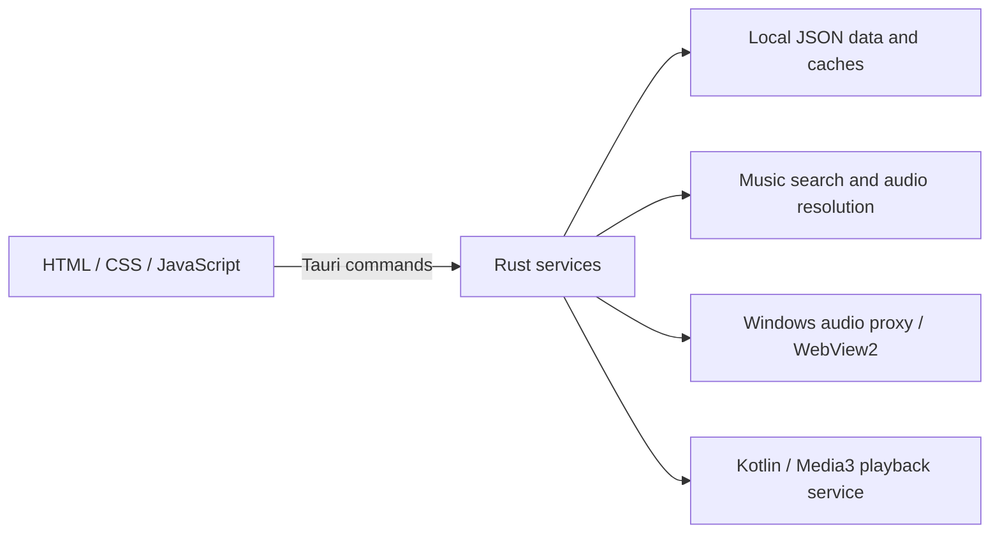

<p align="center">
  
</p>

<h1 align="center">Antares</h1>

<p align="center">A personal music player for Windows and Android, built with Tauri, Rust and JavaScript.</p>

<p align="center"><strong>English</strong> · <a href="README.es.md">Español</a></p>

<p align="center">
  <a href="https://github.com/Hanyer001/antares-actualizaciones/releases/latest">Windows downloads</a> ·
  <a href="https://github.com/Hanyer001/antares-actualizaciones/releases/tag/android-v0.3.3-beta.1">Android beta</a> ·
  <a href="https://hanyer001.github.io/Pagina-Antares/">Product website</a>
</p>

Antares brings music search, playback, library organization and listening-based discovery into a customizable native application. It combines a modular web interface with a Rust backend and a Kotlin playback service on Android.

**Release status:** Windows **0.3.3** is available; Android **0.3.3 Beta 1** is a public test release. Search and playback require an internet connection and depend on external services. Android does not yet check for application updates automatically.

## Highlights

| Area | Capabilities |
| --- | --- |
| Playback | Search by song or link, queue management, shuffle, repeat and session restoration. |
| Albums and artists | Full albums in order, top tracks with continued playback, and an artist-only queue. |
| Library | Playlists, folders, pinned lists, custom covers, descriptions and bulk song actions. |
| Smart playlists | Rules based on favorites, artists, listening history, skips and time since last played. |
| Discovery | Seed-based radio, adjustable discovery and listening contexts such as work or relaxation. |
| Lyrics and audio | Synchronized lyrics, equalizer, leveling and fades, with platform-specific capabilities. |
| Appearance | Themes, fonts, colors, backgrounds, layouts, shortcuts and saved appearance profiles. |
| Personal data | Listening statistics, incognito mode and complete per-user backup and restore. |

Public playlist imports, including Spotify lists with more than 100 tracks, match tracks to playable sources. Text and CSV imports are also supported. See the [feature guide (Spanish)](docs/features.md) for formats and platform differences.

## Engineering overview



- **Shared application logic:** the frontend delegates search, persistence and native integration to Rust through Tauri 2.
- **Platform-specific playback:** Windows resolves audio with a locally patched `rusty_ytdl` crate and uses a WebView audio pipeline. Android uses InnerTube and a native Media3/ExoPlayer service for background playback and media controls.
- **Playback recovery:** temporary audio URLs can be resolved again after a failure, with bounded retries and restoration of the saved position.
- **Testable models:** queue, preferences, matching and library models have JavaScript tests that run without opening Tauri.
- **Distribution:** signed Windows update packages are published in a separate [release repository](https://github.com/Hanyer001/antares-actualizaciones).

The YouTube client changes are documented in [ANTARES_PATCH.md](src-tauri/vendor/rusty_ytdl/ANTARES_PATCH.md). Detailed architecture documentation is available [in Spanish](docs/architecture.md).

## Platform support

| | Windows | Android |
| --- | --- | --- |
| Release channel | Stable 0.3.3 | Public beta 0.3.3 Beta 1 |
| Runtime | WebView2 and Rust | Android WebView, Rust and Kotlin |
| Background playback | System tray integration | Native playback service |
| Audio processing | Web Audio effects | Native effects depend on the device; optional fades |
| Native controls | Mini window and global shortcuts | Notifications, lock-screen controls and touch navigation |
| Backups | Per-user export and restore | Export and restore through the document picker |

Windows packages target 64-bit Windows 10/11. The Android beta targets Android 7.0+ on 32-bit and 64-bit ARM. See the [Android guide (Spanish)](docs/android.md) for installation, migration, build instructions and device validation.

## Run locally on Windows

Prerequisites: **Node.js 22+**, npm, Rust with the **MSVC** target, Microsoft C++ Build Tools with the desktop C++ workload, and WebView2.

```powershell
git clone https://github.com/Hanyer001/Antares.git
cd Antares
npm ci
```

Download `yt-dlp.exe` from the [official releases](https://github.com/yt-dlp/yt-dlp/releases/latest), create `src-tauri/binaries/`, and save it as:

```text
src-tauri/binaries/yt-dlp-x86_64-pc-windows-msvc.exe
```

This sidecar is needed for search and playlist queries; Windows audio extraction uses `rusty_ytdl`. The executable is not tracked in Git.

```powershell
npm run dev
```

The interface calls Tauri APIs, so opening `src/index.html` directly in a browser does not launch the application. Android requires its own SDK, NDK, Java and Rust targets; follow the [development guide (Spanish)](docs/development.md).

## Checks

Run from the repository root:

```powershell
npm test
npm run check:rust
npm run test:rust
```

The Rust desktop checks require the configured native environment and sidecar. Tests that need external services or signed release packages are ignored by default and run separately; see [development](docs/development.md) and [release documentation](docs/releases.md).

## Repository map

```text
assets/branding/          Source application icon
docs/                    Feature, architecture, data and release guides
scripts/                 Android builds, Windows releases and diagnostics
src/                     Web interface and JavaScript models
src-tauri/src/           Rust services, persistence and Tauri commands
src-tauri/gen/android/   Android project and Kotlin playback service
src-tauri/vendor/        Patched native YouTube extraction dependency
tests/                   JavaScript tests
```

## Documentation

The main README is available in [Spanish](README.es.md). The detailed guides below are currently in Spanish:

- [Features and usage](docs/features.md)
- [Development and tests](docs/development.md)
- [Architecture](docs/architecture.md)
- [Local data and backups](docs/data.md)
- [Android](docs/android.md)
- [Builds and release publishing](docs/releases.md)
- [Changelog](CHANGELOG.md)

For a Windows release, the PowerShell release script prepares the installer, its fixed-name download copy and the update manifest. Follow the release guide to configure signing and publish the matching artifacts; a source commit alone does not distribute an update.

## Feedback and credits

Report a problem in [Issues](https://github.com/Hanyer001/Antares/issues), including the version, operating system, reproduction steps and expected behavior. A public example song link helps with playback reports.

Built with Tauri 2, Rust, HTML, CSS and JavaScript ES modules. Playback and search integrations include `rusty_ytdl`, yt-dlp, InnerTube and Media3/ExoPlayer; synchronized lyrics use LRCLIB. Local font credits are preserved in [src/fonts/LEEME.txt](src/fonts/LEEME.txt).
